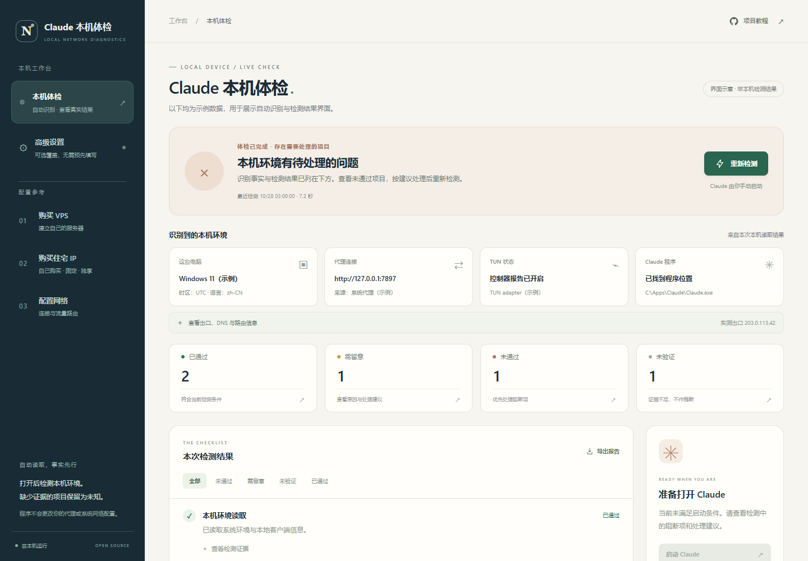

# Claude Network Guide

从自己购买 VPS、购买固定独享住宅 IP，到配置网络、检查实际出口，再启动 Claude 的中文教程和本地检测工作台。

## 双击本地程序，直接检测

**[下载 Windows x64 本地程序](https://github.com/clm031102-source/claude-network-guide/releases/latest/download/ClaudeNetworkGuide-Windows-x64.zip)** · [打开方法](docs/desktop-app.md) · [版本与校验值](https://github.com/clm031102-source/claude-network-guide/releases)

完整解压后双击 `ClaudeNetworkGuide.exe`。独立窗口自动读取本机代理、客户端端口、网卡/TUN、路由/DNS和Claude安装位置，再实际测试网络。无需安装Python，也不用先填写IP、代理端口、安装路径或采购声明。结果在本机显示，没有云端报告后台；不修改系统网络或读取账号登录态。

## 第一次配置，从这里开始

不需要先认识下面所有工具。按[零基础完整流程][beginner-guide]逐步操作，完成一步再继续下一步。

- **[零基础从这里开始][beginner-guide]**：从准备资料、购买，到配置、检测和以后维护，按顺序带你完成。
- **[下载 Word 保姆指南][word-guide]**：保存当前版本，方便离线阅读；文中的链接可返回本仓库对应章节。
- **[复制给 AI 的完整提示词][agent-handoff]**：把完整提示词交给能操作本机的 AI，按你的实际进度带着做；也可打开[纯文本提示词][agent-prompt]。

Word 是当前版本的离线读物。**最新步骤与修订以本仓库的在线原文为准**；不确定某一步是否更新时，点击 Word 内对应的章节链接查看。

**本教程要求：住宅 IP 由你本人购买并独享，长期固定使用。** 这是本项目的线路选择要求，不是 Anthropic 的官方采购要求，也不是账号不被限制的保证。普通 VPS 的机房 IP 不会因为“独享”自动变成住宅 IP。

## 流程总览与详细章节

| 步骤 | 要做的事 | 完成标准 |
|---|---|---|
| 1 | [购买 VPS](docs/01-buy-vps.md) | 确认系统、线路、流量、SSH、救援控制台与退款条款 |
| 2 | [自己购买固定独享住宅 IP](docs/02-buy-residential-ip.md) | 拿到独享、固定、协议及售后证据，确认最终出口 |
| 3 | [部署与配置网络](docs/03-network-setup.md) | REALITY / TLS 主备入口均到达同一住宅出口 |
| 4 | [启动检测工作台](docs/04-preflight-check.md) | 看懂通过、警告、失败和未验证，再重新检测并启动 |
| 5 | [逐项验收](docs/validation.md) | TCP、UDP、IPv6、DNS、断线行为分别留下证据 |
| 6 | [备份与维护](docs/maintenance.md) | 可以升级，也可以恢复最后一个可用版本 |

[完整目录](docs/tutorial.md) · [两套上游项目的核心逻辑与能力映射](docs/core-logic.md) · [高级功能](docs/advanced.md) · [官方参考资料](docs/sources.md)

## 程序与源码运行

Windows 普通使用者直接使用上面的便携程序。关闭窗口即关闭自己的本地服务，保留电脑上原有的代理软件。

源码版供维护者和其他平台使用，需要 Python 3.10+。在仓库目录运行 `python -m app.server`（部分系统为 `python3`），Windows 也可双击 `启动检测.cmd`。它会打开本地浏览器界面，并自动检测一次；默认选择 `127.0.0.1:8765` 至 `8774` 的可用端口。桌面版使用系统分配的空闲回环端口。

高级设置只在需要覆盖自动识别时使用，留空即自动。未填写预期IP时报告实测出口和通道一致性，不把它当住宅或独享认证；没有采购勾选项，也不会因没填表制造失败。



每次点击启动Claude都会重新检测，并验证本轮发现的官方客户端位置。检测结果区分通过、提醒、失败和未验证，不把超时说成无泄漏。它没有后台断线阻断，完整范围见[检测说明](docs/04-preflight-check.md)。

## 本仓库里有什么

```text
app/                 新的本地检测内核、HTTP 服务与操作界面
docs/                原创中文教程、核心逻辑、验收和维护说明
modules/vps/         完整引入并适配品牌与路径的 VPS 上游源码、脚本、网站与文档
modules/switcher/    完整引入并适配品牌与路径的切换器上游源码、界面、探针与测试
tests/               新工作台的隔离测试
启动检测.cmd          Windows 启动入口
```

两个源项目的完整文件保存在 `modules/`，用于学习、审查与明确选择后的高级使用。**阅读仓库不会授权安装它们。** 旧模块涉及系统设置、服务、账号快照等行为，与新工作台的只读检测边界不同。

主要入口：[VPS 模块](modules/vps/README.md)、[部署脚本与技能说明](modules/vps/skills/claude-network-guide/SKILL.md)、[切换器模块](modules/switcher/README.md)、[Windows 模块](modules/switcher/windows/README.md)、[Linux 模块](modules/switcher/linux/README.md)。

## 路线图与范围

- 本版本提供：完整教程、本地检测工作台、逐项证据、启动前重检、完整上游模块与来源追溯。
- 需要用户在自己的线路上完成：住宅属性采购核验、实际客户端 TCP / UDP / IPv6 验收、断线阻断演练。
- 后续方向：更多代理客户端的运行时接口、可复现的 DNS 权威日志测试、按平台验证的防火墙阻断、更多平台的原生安装包。

我们不使用“信任评分达到某个数字即可保号”作为验收标准；检测也不替代服务商及平台的当时有效条款。使用地区、账号与付款资格请按 [Anthropic 官方政策入口](https://www.anthropic.com/supported-countries)核对，出口国家不能证明使用资格。

## 许可证与反馈

本项目新增部分见 [LICENSE](LICENSE)。第三方代码保留各自许可证和来源声明：[VPS MIT 许可证](modules/vps/LICENSE)、[切换器 MIT 许可证](modules/switcher/LICENSE)。品牌改写不改变原作者署名与授权义务；固定来源、原始文件清单见 [NOTICE.md](NOTICE.md) 和 [UPSTREAM.json](UPSTREAM.json)，能力及适配关系见[核心逻辑](docs/core-logic.md)。

普通问题请提交[本项目 Issue](https://github.com/clm031102-source/claude-network-guide/issues)。提交前移除 IP、订阅地址、UUID、密码、密钥、Cookie 和账号资料。安全问题见 [SECURITY.md](SECURITY.md)。

[beginner-guide]: docs/beginner-guide.md
[word-guide]: https://github.com/clm031102-source/claude-network-guide/raw/refs/heads/main/docs/downloads/%E9%98%B2%E5%B0%81%E6%8C%87%E5%8D%97_%E4%BF%9D%E5%A7%86%E8%81%94%E5%8A%A8%E7%89%88.docx
[agent-handoff]: docs/agent-handoff.md
[agent-prompt]: prompts/带我完成配置.txt
