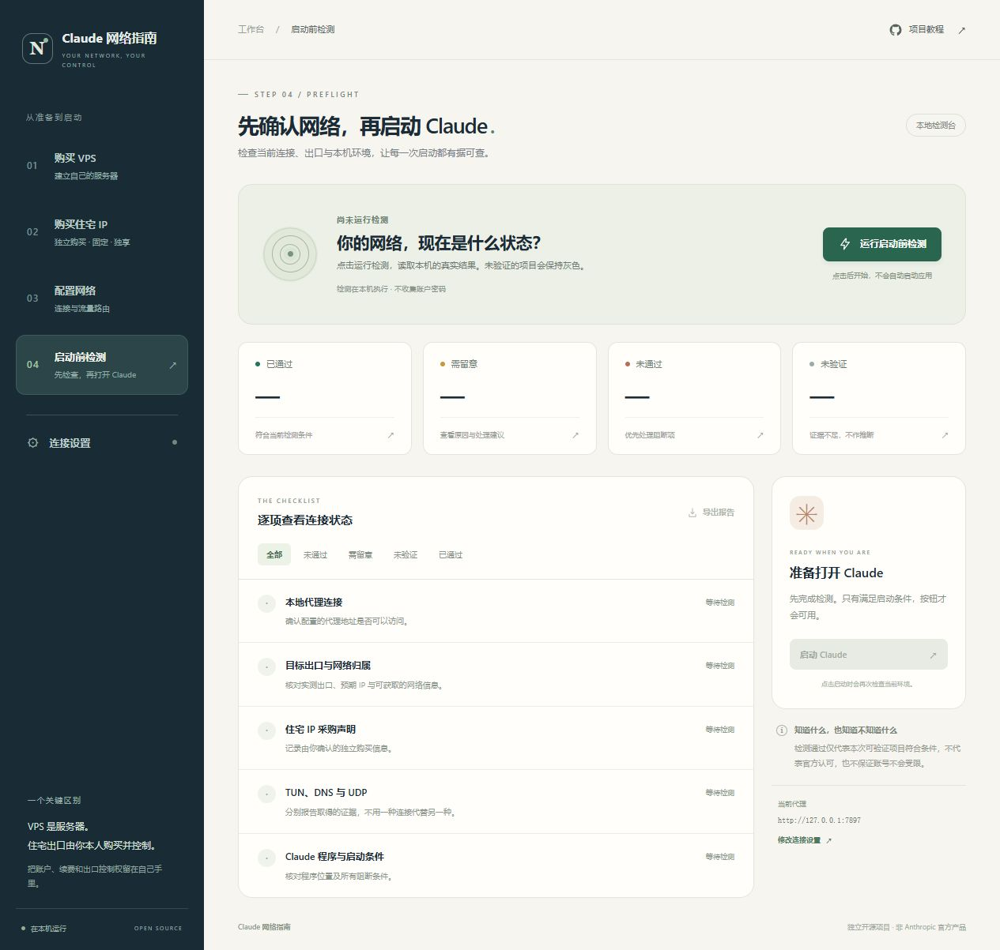

# Claude Network Guide

从自己购买 VPS、购买固定独享住宅 IP，到配置网络、检查实际出口，再启动 Claude 的中文教程和本地检测工作台。

**本教程要求：住宅 IP 由你本人购买并独享，长期固定使用。** 这是本项目的线路选择要求，不是 Anthropic 的官方采购要求，也不是账号不被限制的保证。普通 VPS 的机房 IP 不会因为“独享”自动变成住宅 IP。

## 按这个顺序开始

| 步骤 | 要做的事 | 完成标准 |
|---|---|---|
| 1 | [购买 VPS](docs/01-buy-vps.md) | 确认系统、线路、流量、SSH、救援控制台与退款条款 |
| 2 | [自己购买固定独享住宅 IP](docs/02-buy-residential-ip.md) | 拿到独享、固定、协议及售后证据，确认最终出口 |
| 3 | [部署与配置网络](docs/03-network-setup.md) | REALITY / TLS 主备入口均到达同一住宅出口 |
| 4 | [启动检测工作台](docs/04-preflight-check.md) | 看懂通过、警告、失败和未验证，再重新检测并启动 |
| 5 | [逐项验收](docs/validation.md) | TCP、UDP、IPv6、DNS、断线行为分别留下证据 |
| 6 | [备份与维护](docs/maintenance.md) | 可以升级，也可以恢复最后一个可用版本 |

[完整目录](docs/tutorial.md) · [两套上游项目的核心逻辑与能力映射](docs/core-logic.md) · [高级功能](docs/advanced.md) · [官方参考资料](docs/sources.md)

## 启动本地工作台

需要 Python 3.10 或更新版本。新工作台只使用 Python 标准库，没有额外 Python 依赖。

Windows：下载本仓库并解压，双击根目录的 **`启动检测.cmd`**。也可以在仓库目录运行：

```powershell
py -3 -m app.server
```

macOS / Linux：在仓库目录运行：

```bash
python3 -m app.server
```

也可以运行 `bash start.sh`。

按终端给出的地址打开本地页面。优先监听 `127.0.0.1:8765`，被占用时依次尝试至 `8774`，不结束已有进程，也不对局域网或公网开放。先填本人购买的住宅 IPv4 和本机代理地址，再点击检测。不要把住宅代理的账号密码填入工作台；需要认证的上游代理由你自己的客户端管理。

新界面把采购确认、网络配置、检查证据和启动操作放在同一个流程里。每次通过工作台启动 Claude 都会重新检测，旧的绿色结果不会直接成为启动许可。



> 检测默认只读：不改系统时区、地区、语言、IPv6、DNS 或防火墙，不读取 Claude 的 Cookie、密码和登录态。页面打开后不自动进行网络探测；点击检测或检测后启动才会发起固定目标的网络请求。它没有后台断线保护，不能代替网络层阻断。具体检测范围见[检测说明](docs/04-preflight-check.md)。

## 本仓库里有什么

```text
app/                 新的本地检测内核、HTTP 服务与操作界面
docs/                原创中文教程、核心逻辑、验收和维护说明
modules/vps/         完整引入并适配品牌与路径的 VPS 上游源码、脚本、网站与文档
modules/switcher/    完整引入并适配品牌与路径的切换器上游源码、界面、探针与测试
tests/               新工作台的隔离测试
启动检测.cmd          Windows 启动入口
```

两个源项目的完整文件保存在 `modules/`，用于学习、审查与明确选择后的高级使用。**阅读仓库不会授权安装它们。** 旧模块涉及系统设置、服务、账号快照等行为，与新工作台的只读检测边界不同。

主要入口：[VPS 模块](modules/vps/README.md)、[部署脚本与技能说明](modules/vps/skills/claude-network-guide/SKILL.md)、[切换器模块](modules/switcher/README.md)、[Windows 模块](modules/switcher/windows/README.md)、[Linux 模块](modules/switcher/linux/README.md)。

## 路线图与范围

- 本版本提供：完整教程、本地检测工作台、逐项证据、启动前重检、完整上游模块与来源追溯。
- 需要用户在自己的线路上完成：住宅属性采购核验、实际客户端 TCP / UDP / IPv6 验收、断线阻断演练。
- 后续方向：更多代理客户端的运行时接口、可复现的 DNS 权威日志测试、按平台验证的防火墙阻断、原生安装包。

我们不使用“信任评分达到某个数字即可保号”作为验收标准；检测也不替代服务商及平台的当时有效条款。使用地区、账号与付款资格请按 [Anthropic 官方政策入口](https://www.anthropic.com/supported-countries)核对，出口国家不能证明使用资格。

## 许可证与反馈

本项目新增部分见 [LICENSE](LICENSE)。第三方代码保留各自许可证和来源声明：[VPS MIT 许可证](modules/vps/LICENSE)、[切换器 MIT 许可证](modules/switcher/LICENSE)。品牌改写不改变原作者署名与授权义务；固定来源、原始文件清单见 [NOTICE.md](NOTICE.md) 和 [UPSTREAM.json](UPSTREAM.json)，能力及适配关系见[核心逻辑](docs/core-logic.md)。

普通问题请提交[本项目 Issue](https://github.com/clm031102-source/claude-network-guide/issues)。提交前移除 IP、订阅地址、UUID、密码、密钥、Cookie 和账号资料。安全问题见 [SECURITY.md](SECURITY.md)。
