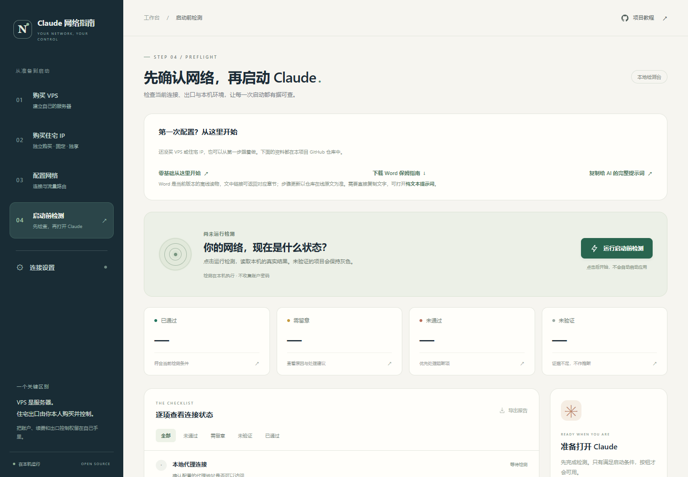

# 防封指南

Claude 网络配置与使用：零基础完整版。配套项目：**claude-network-guide**。这份指南从第一次购买服务器开始，带你整理住宅出口、配置电脑、运行检查，再处理注册、登录、订阅和日常维护。

版本：2026.10.28-r2 · 更新日期：2026 年 10 月 28 日。 [下载同版 Word](downloads/防封指南_保姆联动版.docx) · [复制完整 AI 提示词](agent-handoff.md)

本文是公开仓库与 Word 版本共用的正文。软件界面、套餐和平台规则可能变化；按钮以你眼前的版本为准，技术细节以本文链接的仓库文件和官方说明为准。不要只根据旧截图操作。

<!-- CHAPTER_INDEX_START -->

1. [第一章 先知道这份指南怎么用](#chapter-01)
2. [第二章 准备工具，认清几个常用词](#chapter-02)
3. [第三章 先买 VPS，不要一开始就买错产品](#chapter-03)
4. [第四章 自己购买固定独享住宅出口](#chapter-04)
5. [第五章 把资料安全交接，确定线路怎么走](#chapter-05)
6. [第六章 部署服务器，先做基础网络](#chapter-06)
7. [第七章 在 Windows 上配置代理客户端](#chapter-07)
8. [第八章 下载并启动本地检测工作台](#chapter-08)
9. [第九章 注册、登录、付款，都走本人官方流程](#chapter-09)
10. [第十章 遇到问题，按层排查，不重新折腾一遍](#chapter-10)
11. [第十一章 怎样验收，怎样向别人求助](#chapter-11)
12. [第十二章 让你信任的 agent 手把手带做](#chapter-12)

<!-- CHAPTER_INDEX_END -->

<a id="chapter-01"></a>

## 第一章 先知道这份指南怎么用

### 你最终要做成什么

你需要的结果是一条自己能够管理、出现问题可以恢复的网络，以及一套能看懂结果的检查流程。完成后，你知道钱花在了什么地方、网站看到哪个出口、哪些检查已经做过、出问题该找谁。这里的“防封”只能理解为减少配置错误、保护账号资料；没有任何程序或 IP 能保证账号永远不受限制。

全流程分为六步：购买 VPS，购买并核验固定独享住宅 IP，部署服务器，配置电脑客户端，运行启动前检测，最后在符合条件时注册或登录。VPS 和住宅 IP 可能来自两个订单；也可能是同一款住宅 VPS 同时满足两项要求，后文会教你区分。

如果你已经有服务器，不必重新购买。先读第三、四章，把现有产品与要求对照；确认满足，再继续。已有可用 Claude 账号也不用为了跟教程一致而清空电脑或重新注册。保留现有资产，再补上缺少的验证。

### 先决定自己做哪一部分

购买、账号登录、付款和身份核验由你本人完成。技术配置可以自己做，也可以交给你信任、能够执行本机操作的 AI 助手。下文把这种助手称为 agent。它可能能运行命令，但不会天然知道你同意它修改哪台机器；你需要明确目标和范围。

从第六章起，如果出现看不懂的设置，先看这一章的目标和完成标准，再把末章提示词交给可信 agent。无需凭感觉修改几十个开关，也不要把整个教程当成一条可以无差别执行的安装命令。

建议每次完成一章就在自己的记录里写下日期、结果和下一步。暂停时保留配置与文件，下次从尚未完成的位置继续；不用反复重装。遇到“未验证”，就把它当作剩余工作，不能为了继续操作改成“通过”。

### 使用前的基本条件

先核对自己能否按平台要求使用 Claude。官方注册帮助对实际所在地区有要求，网络出口国家不能替代人的实际所在地或其他资格。账号、付款资料和验证信息都使用你本人真实、可控制的资料。条件不符合或不清楚时，先向官方核实，网络准备本身不会改变资格。[Claude 官方注册与订阅说明](https://support.claude.com/en/articles/8325609-how-do-i-sign-up-for-the-pro-plan)

本章完成标准：你知道自己要沿哪条路径做、哪些步骤需要本人完成，以及做到哪一步算真正完成。在线入口：[项目首页](../README.md)、[完整技术目录](tutorial.md)。

<a id="chapter-02"></a>

## 第二章 准备工具，认清几个常用词

### 先准备这些东西

Windows 主线需要一台你能正常使用的电脑、可以收信的本人邮箱、用于购买的合适付款方式，以及一个保存订单和配置的私有位置。公司电脑或受管理电脑先确认权限；不要直接关闭安全软件、绕过公司管理或修改不属于你的网络。

在“文档”中建立自己的资料文件夹，例如“我的网络配置”。它可以保存订单说明、脱敏检查记录和恢复说明。密码与私钥优先放密码管理器或权限受限的独立位置；不要把资料文件夹设成公开网盘链接，也不要放进准备上传 GitHub 的项目目录。

再建立一份文字记录，依次写：VPS 商家和订单、机房、系统、到期日、退款截止日；住宅 IP 商家和订单、固定期限、协议、售后条件；电脑上的代理客户端名称；当前完成到第几章。暂时不知道的项目写“待确认”，不要猜。

### 六个词，够你看懂主线

**VPS** 是你租用的一台远程电脑。它通常没有桌面，你通过管理后台和远程连接配置它。**IP** 是网络地址；本教程最关心的是目标网站最后看到的“出口 IP”。服务器入口地址和最终出口地址可能不同。

**住宅 IP** 是你购买的住宅或 ISP 类出口。本项目要求固定、独享、由本人购买并控制。固定表示不会每次连接就换；独享表示不是一群买家同时共用。**代理客户端** 是电脑上负责把流量送入指定线路的软件，这里以 Clash Verge Rev 为主要例子。

**订阅链接** 是把节点和规则导入客户端的一条地址，里面可能带访问凭据。它相当于线路钥匙，不能公开发给别人。**TUN** 是代理客户端接管更多系统流量的一种方式，常在界面里叫虚拟网卡；开关打开不代表所有程序、所有协议都已经正确走代理。

后面还会看到 DNS。它负责把网址转换成网络可用的地址，可以理解成查地址的步骤。网页流量走了你想要的线路，不代表查地址的过程也一定相同，因此要单独核对。TCP 和 UDP 则是不同传输方式：浏览网页正常，不足以证明语音、视频或浏览器的 UDP 请求正常。

### 分清两个容易混淆的窗口

代理客户端负责实际联网；本项目的“Claude 网络指南”工作台负责检测和启动前检查。两者不是同一个程序。工作台显示在浏览器里，并不表示你的配置上传到了某个网站；本地地址以 `127.0.0.1` 开头，表示服务运行在自己的电脑上。

本章完成标准：你已经有记录位置，能区分服务器、出口、客户端与检测工作台。看不懂某个名称时，先在[核心逻辑说明](core-logic.md)找到它的职责，不急着安装更多软件。

<a id="chapter-03"></a>

## 第三章 先买 VPS，不要一开始就买错产品

### 先比较条件，再选商家

本指南不指定必须在哪家买，也不使用邀请链接。第一次先考虑能够短期验证的方案，不因为别人说“长期更划算”就立即年付。价格、库存、税费、退款和换 IP 条款都看下单当天的官方页面，并保存记录。

你购买的是能自行管理的 VPS，不是一个聊天账号，也不只是几条他人提供的节点。向商家确认：有没有独立公网 IPv4，是否支持 root 或管理员权限，能不能重装系统，有没有救援控制台，是否允许你的个人代理用途。若只卖订阅链接，没有服务器管理权限，就不是这里的普通 VPS 部署流程。

基础个人用途可以从轻量配置比较起，例如 1–2 核、1–2 GB 内存，再依据实际使用增加。这个范围是比较起点，不承诺一定够所有任务。当前部署模块支持 Ubuntu 22.04+ 或 Debian 12+；全新机器可以考虑 Ubuntu 24.04 LTS。已有业务的机器不要直接重装成教程示例系统。

### 下单前把账算清楚

看清套餐每月流量、入站是否计费、出站是否计费、超额后收费还是限速。核对续费价格是否与首期相同、优惠是否只适用首月，以及取消续费的位置。住宅出口如果另外收费，要一并计入总预算，避免只看 VPS 价格。

线路体验取决于你自己的网络和时段。优先使用商家允许的测试地址，从常用宽带和手机热点各测一次，注意晚高峰延迟和丢包。不会测试可以让 agent 帮你读取结果；不要把大流量测速当第一步，以免耗掉退款条件允许的流量。

退款规则要看是否有时间窗口、使用量限制和产品例外；换 IP 是否收费、能否自行申请也要问清。把问题发给商家得到书面答复，比只记住聊天群里的口碑更有用。

### 开通后不要急着装东西

在控制台确认实例已经运行，保存服务器 IP、系统、SSH 用户名和端口、订单号、到期时间、救援入口。SSH 是远程管理通道；商家给出的端口不一定是 22，用户名也不一定是 root，以后台真实值为准。

有些商家让你提交公钥，有些先给初始密码。公钥可以交给服务器；私钥不能交出去。初始密码由你在自己的终端输入，不贴进群聊、公开 Issue 或 AI 对话。还没有弄懂登录方式时，先让 agent 解释你后台实际提供的选项。

看到“付款成功”还不算本章完成。应确认机器确实存在、身份信息齐全、管理入口可打开，并知道 SSH 失效时如何用救援控制台恢复。若商家迟迟未开通，先查询订单或联系客服，不重复下单。具体核对表见[购买 VPS](01-buy-vps.md)。

<a id="chapter-04"></a>

## 第四章 自己购买固定独享住宅出口

### 这一步是本项目的明确要求

住宅出口要由你本人购买、控制凭据、续费和售后，不能依赖别人随时可能收回的共享节点。普通 VPS 即使 IP 只分给你，也可能是机房 IP；“独享”不自动等于“住宅”。反过来，一个标为住宅的代理池也可能不断轮换，并不是固定独享。

如果你买的是住宅 VPS，确认套餐同时给你服务器管理权限和符合要求的最终出口。两项都满足，就不需要为了教程顺序再买一份重复产品。如果是普通 VPS，通常还要购买独立住宅代理或住宅 VPN，再把它接在 VPS 后面。

购买要求不代表 Anthropic 官方要求用户购买住宅 IP。固定、独享有助于你管理线路和排查变化，但不能保证 IP 没有历史问题，也不能改变账号资格。不要相信“某个评分满分，所以一定不会封”这样的承诺。

### 可以直接发给商家的问题

告诉商家：“我需要本人独享、长期固定的住宅或 ISP IPv4，作为个人网络出口。请说明购买期内是否固定、重连或续费是否会变、是否同时卖给其他用户、支持哪些协议和认证方式、能否从我自己的 VPS 连接，以及换 IP 和退款条件。”

接着问其 ASN 或运营商信息、合法来源说明、月流量、速度、并发和用途限制。ASN 可以理解成运营网络的编号，它能帮助查归属，但单个分类标签不是住宅或独享的最终证明。不同数据库显示不一致时，让商家说明，不用选一个好看的结果结束核验。

协议方面，至少确认它到底卖的是 SOCKS5、HTTP 代理还是 VPN。若写着 SOCKS5，再问是否真正支持 UDP ASSOCIATE；这决定部分 UDP 流量能不能经过它。只支持网页 TCP 的商品，不能直接宣称能保护所有应用和浏览器实时通信。

### 到货后怎样检查

把承诺的 IPv4、固定期限、独享说明、协议和售后条款记下来。让配置者通过该出口向两个不同查询服务发起请求，两个结果都应与购买的地址一致。隔一段时间、断开重连后再看，确认没有变成轮换池。

正式使用前完成退款窗口内的基本测试：实际连接能否建立、常用时段是否可用、TCP 和需要的 UDP 是否正常。发现产品与承诺不符，带上时间、错误和脱敏结果找商家处理；不要反复换 IP 来掩盖其实是本机配置错误的问题。

本章完成标准：你能回答“最终出口是哪一个、由谁控制、多久固定、是否独享、支持什么协议、出问题找谁”。凭据只留在自己的私有记录中。更详细的采购问法和判断标准见[购买住宅 IP](02-buy-residential-ip.md)。

<a id="chapter-05"></a>

## 第五章 把资料安全交接，确定线路怎么走

### 先把自己的结构选清楚

结构 A 是住宅 VPS 直接出口：你的电脑连到住宅 VPS，再由它访问目标服务。此时服务器的已确认住宅公网地址也是预期最终出口。

结构 B 是普通 VPS 中转：你的电脑先连 VPS，再由 VPS 连你另购的住宅服务，最后访问目标。网站应该看到住宅 IP，不应该看到中间 VPS 的机房 IP。只把住宅凭据写进笔记而没真正接入，不会改变出口。

两个结构都可以有主、备入口。主入口与备用入口是两扇进入同一条网络的门，不能因此偷偷换成两个不同住宅地址。切换入口时保持同一个已核验出口，住宅服务失效时停止受保护连接，而不是自动直连。

### 给 agent 什么，哪些由自己输入

你可以告诉 agent：电脑系统、现有代理客户端、VPS IP、SSH 用户名和端口、希望使用的服务器别名、线路结构、住宅最终 IPv4、住宅协议，以及私有凭据文件在本机的位置。这些信息只在你信任的工作环境使用，公开报告要脱敏。

密码、私钥正文、住宅账号密码、订阅链接、验证码、银行卡信息和身份材料不直接粘贴给 agent。需要输入时，由你在真实终端、服务商后台或官方页面完成；agent 可以解释接下来做什么。若它要求你把 Cookie 或登录凭证发到某个陌生网站，先停下确认用途。

你还需要明确范围：“这次操作我指定的这一台 VPS 和这台电脑上的指定代理客户端；先保留现有配置。不要重装已有业务，不清空 Claude 数据，不新增付费项目，不代我登录、支付或提交身份材料。”这能避免工具看见一份安装说明，就把它误当成你要求立即执行所有步骤。

### 开始前保留恢复办法

让配置者先保存电脑现有代理配置和 VPS 相关配置。还要说明具体备份放在哪里、能恢复到哪个时间点、网络断开后怎样进入救援控制台。文件存在不代表能恢复，至少确认备份可读、内容不为空、对应当前机器。

如果服务器别名已经指向别的机器，换一个新名字；不要覆盖旧条目。如果对方只能聊天、不能执行本机操作，可以让它一步一步指导，但不能把生成了命令或模板称作部署完成。

本章完成标准：线路结构、目标机器、可修改范围与恢复办法已经写清，秘密没有进入公开位置。可把[网络配置说明](03-network-setup.md)和[仓库协作边界](../AGENTS.md)一起交给配置者。

<a id="chapter-06"></a>

## 第六章 部署服务器，先做基础网络

### 服务器部署和电脑检测是两件事

服务器端需要远程连接、安装服务和设置防火墙，适合由有执行能力的可信 agent 带做。本项目的本地检测工作台不会代替这些步骤。第一次不建议把网上的一整行未知安装命令直接粘贴到服务器。

使用本仓库的网络部署说明。先下载项目、检查现有脚本和当前机器，再开始。Windows 下远程部署脚本需要 Bash 环境，通常使用 WSL；这与第八章的本地工作台不同，后者只需要 Python。不知道是否已有 WSL 时先检查，不必为了打开检测页面安装一套 Linux。

### 按这个顺序推进

第一步是验证 SSH。配置者先确认服务器身份，建立独立密钥，用第二个终端验证能够登录，再关闭密码登录。原有连接和救援入口先保留，防止一改配置就把自己锁在外面。

第二步是部署基础服务，包括服务器依赖、防火墙、证书、代理入口和订阅。服务器自己的时区用于日志管理；这不是修改你电脑时区的理由。防火墙应保留管理通道，只开放本次用到的入口；面板尽量限制管理来源，不靠一个难猜的网址代替访问控制。

第三步是配置主、备入口。项目保留 REALITY 主入口和 TLS 备用入口，这是两种连接方式，名称不需要背。你需要确认两个入口都能在客户端实际连接，并最终到达第四章购买的同一个住宅 IP。

第四步是接入住宅出站。结构 A 核验服务器自己的住宅出口；结构 B 必须把两个入口收到的请求都转交住宅服务。让配置者特别说明住宅不可用时会怎样，不能默认改走 VPS 机房地址或本机直连。

最后设置证书续期、规则更新和备份，并检查服务是否能在重启后恢复。证书用来证明你连接的是可信的服务；出现证书错误先解决原因，不要勾选跳过证书验证来让页面暂时打开。

### 本次不需要把高级功能全部装上

完整源模块还包括 CLIProxyAPI、账号快照、系统守护和自动修复。它们不是新工作台检测的前提。默认先做基础网络，额外功能等你确实需要时再决定。

现有完整部署脚本会准备部分高级 API 的用户、端口和网页入口；纯网络方案需要配置者关闭未使用的公网入口，并单独安排网络维护任务。完整服务栈的验收器也包含 API 检查，不能为了变成全绿而擅自扩大部署范围。这些差异已经写进[网络部署章节](03-network-setup.md)，可以直接让 agent 阅读处理。

### 你应当拿到什么

一份本机私有交付文件，包含自己的 SSH 别名、订阅和管理入口、备份位置；一份脱敏结果，说明哪些阶段完成、主备出口是否一致、哪些项目仍未验证。真实密码和订阅放在私有文件中，不出现在公开仓库或报告里。

若某一步失败，让配置者说明失败阶段、原因和重试办法，不默认重新买服务器。基础网络部署完后，再进入电脑客户端配置；“服务器已运行”还不能等同“你的电脑已经走这条网络”。

<a id="chapter-07"></a>

## 第七章 在 Windows 上配置代理客户端

### 先确认电脑上有没有现成客户端

打开开始菜单，查找 Clash Verge Rev 或你已经使用的代理软件。已有客户端时先记录名称、版本、当前订阅和启用状态，不要再安装第二套并同时打开 TUN。多个工具同时修改路由，容易让测试结果相互矛盾。

没有客户端时，从 [Clash Verge Rev 官方发布页](https://github.com/clash-verge-rev/clash-verge-rev/releases)选择适合自己电脑架构的正式安装包。Windows 可以在“设置 → 系统 → 关于”查看系统类型；不确定 x64 或 ARM64 时，把这一项告诉 agent。不要下载聊天群中来历不明的修改版。

安装按系统和官方安装器提示进行。遇到服务安装或管理员权限请求，先确认它来自你刚打开的官方客户端，并知道这一步用于虚拟网卡接管。如果公司管理策略阻止安装，联系管理员，不擅自关闭策略。

### 导入自己的订阅

打开客户端的订阅或配置页面，使用私有交付文件中的 **Clash 订阅**创建远程订阅。不同版本的入口名称可能不同；若不确定，查看当前界面和官方说明，不要把无关链接粘贴进脚本编辑器。

订阅地址由你自己复制，不上传在线转换网站。导入成功后，应看见本项目对应的节点和规则配置。确认主、备两个入口都存在，再选择你需要的节点。导入显示失败时记录完整错误并遮盖链接，先查证书和网络连通，不公开截图里的订阅凭据。

按既定方案启用规则模式和 TUN。规则模式让不同流量按配置走对应路线；它不意味着所有网站都代理。国内服务保持直连，目标服务与其需要的 DNS 按指定线路处理，未匹配流量怎么走也必须明确。

### 找到真正的本机代理地址

在客户端设置中寻找 HTTP、混合端口或 Mixed Port。把实际端口写到记录中。后面工作台要填的可能是 `http://127.0.0.1:7897`，但 **7897 只是本项目默认示例，不是每台电脑都用这个数**。你的客户端如果显示别的端口，就使用实际值。

这里的 `127.0.0.1` 表示本机。初学者不需要为了检测打开“允许局域网连接”，更不要把无认证代理监听暴露到公网。住宅凭据由实际承担住宅出站的 VPS 或客户端保管：结构 B 通常配置在 VPS 上，不需要再在电脑重复接一遍住宅代理。工作台的网址不接收这些账号密码。

### DNS、UDP 与 IPv6 要分别检查

让配置者核对目标服务的 DNS 实际经过哪条线路、是否用了预期加密解析、海外解析失败后会不会意外转去另一个未经确认的出口。客户端显示 `198.18.x.x` 可能只是 fake-IP 的本地结果，不能据此判断上游 DNS 已经合格。

浏览器可能有自己的安全 DNS，系统也可能有不同解析设置。不要看到这个词就全部关闭；先确认它是否影响当前方案，再说明具体改动、保留原值并验证。macOS 的相关网络隐私功能同样按真实路径处理，不机械套用 Windows 设置。

UDP 和 IPv6 有单独的路径，不能只打开网页就算验收。住宅产品不支持所需 UDP 时，应明确停止相关流量并说明哪些功能会受影响；IPv6 也不能在代理失效时悄悄改成另一条直连路径。网络层如何阻断，需要对应系统的配置和实测，工作台不会自动帮你关闭网卡或修改防火墙。

### 完成与分支说明

分别选择主、备入口查询出口，应都等于购买的住宅 IPv4；查看当前内核的连接记录，确认目标请求命中了正确节点。关闭再打开客户端后复测，确保设置真正保存，而不是只在临时窗口改过一次。

macOS 可按所选客户端的官方版本使用同类流程；iPhone 使用对应 Shadowrocket 订阅，不能把 Clash 模板当成同一种格式。OpenClash 路由器还要确认电脑流量确实经过它。详细入口在[客户端与网络配置](03-network-setup.md)。本章完成时，你应有一个可说明、可重启恢复的客户端配置，以及真实本机代理地址。

<a id="chapter-08"></a>

## 第八章 下载并启动本地检测工作台

### 第一步：下载 ZIP，先解压再运行

打开[公开仓库的代码首页](https://github.com/clm031102-source/claude-network-guide)，点击绿色的 Code，选择 Download ZIP，保存到自己的下载目录。下载完后，在资源管理器中对 ZIP 选择“全部解压缩”，将解压目录放到容易找到的位置。若从[项目说明](../README.md)进入，先回到仓库的代码首页再找 Code。

不要直接在压缩包预览窗口里双击脚本。打开解压后的文件夹，确认这一层同时能看见 `README.md`、`app` 文件夹和 `启动检测.cmd`。如果外层只有一个同名文件夹，再进入一层。这个同时包含三者的位置就是项目根目录。

### 第二步：安装或检查 Python

Python 是运行工作台所需的程序环境，不要求你学习编程。已有 Python 3.10 或更新版本可以直接使用；没有时打开 [Python 官方下载页面](https://www.python.org/downloads/)，按当前 Windows 安装说明操作。官方可能先提供 Python 安装管理器，再安装实际运行时，跟随官方流程即可。[Python Windows 官方说明](https://docs.python.org/3/using/windows.html)

安装完成后重新打开终端。可以在开始菜单搜索“终端”，输入 `py -3 --version` 并回车；正常会显示 Python 3.x 的版本。若提示找不到 `py`，试 `python --version`；能显示满足要求的版本，启动脚本也能使用它。若新安装管理器提示尚未安装运行时，按官方提示安装稳定的 Python 3 后重试。不要因为命令失败就卸载电脑上所有 Python，其他软件可能正在使用它。

版本满足要求后关闭检查窗口。工作台使用 Python 标准库，不需要你再搜索几十个依赖包，也不用安装服务器部署用的 WSL。

### 第三步：打开工作台

回到项目根目录，双击 `启动检测.cmd`。会出现一个本地服务窗口，并显示实际访问地址；浏览器若没有自动打开，就复制该地址到地址栏。默认优先使用 `http://127.0.0.1:8765`，被占用时会尝试后续端口，直到 8774。以服务窗口实际输出为准，不反复硬输 8765。

这个窗口运行期间工作台才可访问。不要在页面刚打开时把它关闭；想停止工作台时再关掉服务窗口。程序不会为了占用端口而结束其他软件，也不需要把面板公开给局域网。



页面名称是“Claude 网络指南”，左侧按购买、配置、检测和设置组织。打开页面不会自动检测网络；点击检测或启动时才会联系固定测试服务。这些服务能看到请求实际来源，因此先理解线路结构，再运行测试。

### 第四步：填写三个主要信息

进入“连接设置”。住宅 IPv4 填第四章确定的最终公网地址；普通 VPS 中转方案不能误填 VPS 机房 IP。代理地址填第七章找到的 HTTP 或混合端口，例如 `http://127.0.0.1:7897`；不要加入上游用户名和密码。

Claude 路径要指向已经安装的官方客户端，而不是下载好的安装包、桌面快捷方式，也不是名为 `claude` 的命令行程序。官方客户端下载从 [Claude 安装说明](https://support.claude.com/en/articles/10065433-install-claude-desktop)进入，按自己的系统安装。安装结束若自动打开客户端，先正常退出，等检测配置完成再启动。

Windows 需要真实、完整的 `Claude.exe` 文件路径。可以先在开始菜单找到 Claude，查看“打开文件所在的位置”；如果打开的是快捷方式文件夹，再查看快捷方式属性中的目标。路径要包含盘符、全部文件夹和文件名，填写时不加外层引号。没有这个入口或目标不清楚时，让 agent 只读查找安装位置，不自己猜一个路径。

商店或 MSIX 版可能安装在受保护的 `WindowsApps` 中，快捷方式也可能不是普通 exe 目标。当前工作台使用特定的文件与 Anthropic 签名校验；无法读取或识别时会拒绝启动。这不等于官方客户端是假软件。不要修改该目录权限、移走文件或关掉校验，让 agent 核对安装方式并明确报告当前兼容限制。

macOS 目前只接受标准位置的 `/Applications/Claude.app` 或本人主目录下的 `Applications/Claude.app`，并检查签名。Linux 能运行检测面板，但本项目尚未实现经过验证的 Linux 客户端启动流程；官方是否提供 Linux 客户端，与本项目能否启动它是两回事。

### 第五步：保存、检测、再启动

确认住宅 IP 确实由自己购买并控制后再勾选采购声明。默认保留“要求 TUN 证据”；是否要求 UDP，按你真实使用的功能决定。没有理由时不要通过关闭要求来让按钮变绿。点击“保存设置”，再点击左侧的“启动前检测”返回检测页，点击“运行启动前检测”。

绿色“已通过”只表示对应项目取得预期样本；“需留意”是提醒；“未通过”表示发现冲突；“未验证”表示证据不够。完整 DNS 上游等项目目前就可能保持未验证。允许启动不等于所有项目都安全，详细边界见[检测说明](04-preflight-check.md)。

在登录账号前，先跳到第十一章完成实际线路验收，尤其是主备出口、目标连接、DNS、UDP、IPv6 和断线后的行为。先退出 Claude，用无账号测试连接演练；关键路径失败或尚未验证时，先解决或写明限制并完成必要验证，不把“允许启动”当作配置已经验收。

完成线路验收，且本轮关键检查满足后，可以点击“启动 Claude”；程序会重新检测，不使用过期结果。它没有后台持续保护，启动后代理掉线不会自动关闭 Claude，也不阻止你从其他快捷方式打开程序。本章完成标准是你能启动面板、正确填写配置、看懂每一项结果，并已完成使用前所需的线路验收。

<a id="chapter-09"></a>

## 第九章 注册、登录、付款，都走本人官方流程

### 先确认资格，再进入账号页面

进入本章前，确认已经按第八章末尾指引完成第十一章的使用前验收。还在排查网络时，先处理线路，不用注册、付费或反复登录来测试代理是否正常。

网络检测解决的是连接问题，账号和付费资格由官方规则决定。官方注册帮助说明免费与付费服务均有实际所在地要求，并说明注册可能涉及支持地区手机号；具体要求按当时页面和本人情况核对。不要把住宅出口地址当成真实所在地，也不要购买成品账号来替代本人注册。[官方注册帮助](https://support.claude.com/en/articles/8325609-how-do-i-sign-up-for-the-pro-plan)

本次整理时，[官方支持地区入口](https://www.anthropic.com/supported-countries)重定向到标注 2026 年 11 月 12 日生效的政策页，晚于本版整理日期。阅读时检查生效日期，适用版本不清楚就向官方询问，不把未来条款直接当成当前结论。

### 注册或登录

符合条件后，在浏览器地址栏进入 [Claude 官方登录页](https://claude.ai/)。使用本人长期控制的邮箱，按页面提供的邮件登录或 Google 登录流程完成。验证码、邮件登录链接和账号密码由本人处理，不交给陌生人或 agent 代收。已有账号直接登录，不需要为了本指南再建新号。

原指南里清除设备 ID、删除凭证、把旧账号痕迹“清干净”的做法不作为这里的常规准备。那可能删除有效登录状态、干扰其他工作，也不能证明会改善账号状态。只有明确的故障、可恢复备份和本人同意，才处理对应应用数据，不清空整台电脑。

### 根据需求选择订阅，不按“养号日程”付款

需要付费功能时，从账号内的设置和账单入口查看当前套餐、总价、税费、计费周期和自动续费。核对付款所对应的 Claude 账号，再由本人确认。网页与官方移动端可能有不同的账单渠道，选择适合自己的官方方式；没有依据要求所有人只能通过 iOS 付款。

本指南不规定注册后必须等一个月、先买 Pro 一周、再等三天升某个套餐，也不承诺某档套餐更不容易被限制。按真实用途、预算和官方规则决定。付款页显示的最新金额和生效时间，优先于旧截图里的美元数字。

填写银行卡账单信息时，使用银行登记的真实资料。拒卡先核对支持的账单地区、地址、余额及银行验证，再联系发卡行或官方支持；不要换成网上找来的地址。[Claude 官方拒卡说明](https://support.claude.com/en/articles/9402418-why-was-my-card-declined)

通过 Apple 购买时，使用本人有资格使用的 Apple 账户和该地区允许的付款方式。不为充值伪造地区、借用他人身份，或把账号交给代充商。购买后保留官方收据，确认账号内显示正确套餐；没有生效时先核对购买账号和订单，不立即再买一次。

### 身份验证与账号限制

页面要求身份验证时，先确认入口来自官方应用或官方帮助，再由本人按流程提交真实有效的材料。官方说明验证可能要求政府签发的照片证件和现场自拍；失败时先检查材料是否清晰、有效，次数用尽或有疑问时走官方帮助渠道。[身份验证说明](https://support.claude.com/en/articles/14328960-identity-verification-on-claude)

不要把证件、自拍、验证码交给“代过 KYC”的人，也不购买别人验证过的账号。出现限制不先推断一定是 DNS 或付费时机造成；保存提示和时间，按官方提供的申诉入口说明真实情况。网络工作台不能解除账号限制。

### 扣款、取消与退款

先看收据是谁收款。Apple 购买的订阅，按 [Apple 账单与订阅入口](https://support.apple.com/billing)管理；需要申请退款时，进入 [Apple 官方退款页面](https://reportaproblem.apple.com/)，选择对应订单和真实原因，按页面等待结果。退款有资格条件，不保证批准；取消续费和退还已扣款也不是同一件事。[Apple 退款说明](https://support.apple.com/en-ie/118223)

网页购买的账单问题从 [Claude 官方帮助中心](https://support.claude.com/)进入支持，不向陌生人发送完整支付凭据。你可以让 agent 帮你整理问题文字，但最终账号验证、提交和付款由本人完成。更多项目边界见[安全说明](../SECURITY.md)。

<a id="chapter-10"></a>

## 第十章 遇到问题，按层排查，不重新折腾一遍

### 先停在出问题的那一层

遇到打不开、超时或红项，先记下时间、正在做的步骤、错误原文和刚改过什么。保存工作，必要时退出 Claude，然后再调整网络。不要同时改 IP、DNS、客户端和账号；一次只处理一个原因，才能知道哪一步有效。

先分辨是购买订单没开通、服务器连不上、代理客户端失败、工作台无法打开，还是 Claude 登录或账单报错。比如工作台页面打不开，优先看本地服务窗口；银行卡被拒则去核对账单，不能都归因于“IP 不干净”。

### 工作台打不开或启动失败

双击脚本一闪而过，先确认 ZIP 已解压，目录内有 `app`，再检查 Python。想保留错误信息，可以在项目根目录的资源管理器地址栏输入 `powershell` 并回车，在出现的窗口执行 `py -3 -m app.server`；如果前面只有 `python --version` 可用，就执行 `python -m app.server`。这条命令必须在项目根目录运行；提示找不到 `app` 时，先检查当前目录。

浏览器提示无法连接，查看服务窗口是否还在、输出的端口是不是 8765，或者已经改为 8766 等。不要因此关闭所有占端口的软件。所有候选端口都占用时，可以让 agent 查明原因，再选择端口，不去结束不认识的进程。

面板提示会话失效，按当前服务窗口地址重新打开页面。保存设置后旧报告清空是预期行为，需要重新检测；不要把清空当作检测数据丢失或账号被登出。

### 出口不一致、UDP 未验证或签名失败

显式代理出口不对，先查填写的端口与选中节点。默认通道和显式代理不一致，再查 TUN 是否真正接管、是否有多个代理同时运行、是否存在排除接口或不同分组。两个入口结果不同，检查是否都接入同一住宅出站。

STUN 没有返回结果，可能是服务不可达、UDP 不支持或路由阻断。它不会证明“没有泄漏”。只有一个目标返回，也不能算两个目标都验证完成；是否因此阻止启动，取决于你是否要求 UDP。观察到明确不同的出口则需要先解决。

Claude 路径或签名失败，核对真实安装位置、是否选到了安装包、是否属于当前无法兼容的商店版；不要重命名别的程序为 Claude.exe，也不要修改代码跳过检查。让 agent 给出限制或修复建议，比强行启动更可验证。

### 维护时保留旧版本

客户端、规则、服务器内核和本项目工作台不要同一时间全部更新。更新前保存当前版本和配置，更新后复测主备出口、DNS、UDP、IPv6 与故障恢复。证书自动续期、规则刷新和备份定时器要定期看是否真正运行，不能因为设置过就一直不查。

换电脑、改宽带、用手机热点、升级客户端、换住宅 IP 都是重新检查的理由。网络恢复后先跑检测，再打开 Claude。备份里可能含密钥和订阅，因此只能放在受控位置；需要恢复时确认是同一台目标机器的版本。

本章完成标准：你能说清错误属于哪一层、下一步只改什么、出问题如何退回。具体维护单元、备份范围和排障入口在[日常维护](maintenance.md)。

<a id="chapter-11"></a>

## 第十一章 怎样验收，怎样向别人求助

### 不只看一个绿色总分

最终验收至少要回答下面这些问题：服务器是否稳定运行，订阅是否可用，主备是否到同一住宅出口，电脑默认通道与指定代理是否一致，Claude 实际连接是否命中正确节点，DNS 上游是否有证据，UDP 和 IPv6 结果是否明确，以及断线后会不会回退直连。

网络层证据与账号结果分别记录。网页能打开说明连接取得某种响应；不代表登录成功，更不代表套餐正常。401、403 或类似状态也要结合请求是否带登录信息理解，不能把收到响应就等同业务可用。

请配置者查看运行中的代理内核，而不是只搜索配置文件。文件里写了规则，重启后可能没有加载，目标连接也可能命中更早的另一条规则。实际连接记录、时间和节点名称，比一句“配置看起来没问题”更有用。

### 做一次可恢复的故障演练

演练前保存工作并退出 Claude，只用不含账号凭据的测试请求。让配置者暂时令住宅出站不可达，确认受保护连接停止，而不是出现 VPS 机房 IP；再测试主入口不可用时，备用入口仍到同一个住宅 IP。

本机代理退出、TUN 关闭或网络切换时，也检查是否出现意外直连。没有设置真正的网络阻断，就把这一点记为未完成，不因为工作台能阻止它自己的启动按钮就说全系统已经保护。工作台没有持续守护，也管不到其他快捷方式。

演练结束要恢复原配置，再重新测一遍。测试中断网属于可能结果，所以先保留能恢复的路径，不在紧急工作时临时试。详细证据标准见[完整验收清单](validation.md)。

### 写一份别人看得懂的记录

自己的完整记录写：测试日期与时区、电脑系统、代理客户端和内核版本、项目版本、宽带或热点、线路结构、预期住宅 IP、两个入口各自结果、DNS / UDP / IPv6 证据、故障演练结果、备份位置和未解决事项。完整 IP 只留私有记录。

给外人求助时保留现象、错误、时间和版本，遮盖 IP、订阅、UUID、Key、密码、私钥、邮箱、订单付款资料和账号信息。工作台“导出报告”会生成脱敏文件，但截图和你自己补充的文字仍要检查。任何报告都不需要附上 Cookie 或完整登录态。

一个有效求助可以这样组织：“我在 Windows 上使用某版本客户端，结构是 VPS 中转到住宅出口。昨天更新客户端后，默认通道检查出现不一致，显式代理检查通过。已恢复原订阅但问题还在，附脱敏结果。请先只读检查路由和 TUN，不重装服务器、不清空账号。”它比“帮我防封”更容易得到具体修复。

### 完成标准要写得诚实

代码检查通过不等于真实网络验收，服务器部署成功不等于用户已经验收。要求交付者逐项写“通过、失败、未验证”，并说明未验证为什么存在、是否影响本次使用。不能以“以后再观察”替代明知道还没测的关键路径。

你应拿到可用配置、私有交付文件、脱敏验收结果、明确的恢复办法和待办事项。全部都对应同一最终版本，这次配置才算有据可查。项目问题通过[仓库安全与反馈说明](../SECURITY.md)选择适当渠道，不在公开 Issue 放敏感数据。

<a id="chapter-12"></a>

## 第十二章 让你信任的 agent 手把手带做

### 可以把繁琐操作交给它，关键选择仍由你掌握

如果实在难以理解，或者你不想亲自动手，可以把下面的提示词发给你信任的 agent，让它按照本指南手把手带你完成。它应先看现状、保留有效配置，再按你授权的机器和范围执行；不需要你先把所有专业词学一遍。

发送前只补充你确定的资料：电脑系统、已有客户端、VPS 是否买好、住宅 IP 是否买好、希望它处理哪些步骤。不知道的写“不知道，请先只读检查”，还没有购买就写“尚未购买，请先帮我比较条件”。不要为了填满表格而编 IP、端口或路径。

可信 agent 应该告诉你它正在处理哪一层、还缺哪项证据，并让你本人完成必要的登录、付款和身份核验。它不能仅凭一段文字自动知道真实目标，也不能因为你说“帮我配置”就去购买服务、修改其他服务器或清空账号。

### 如何配合它完成

让 agent 先阅读本仓库最新文件，并确认你手中的教程版本。如果它没有本机执行能力，就要求每次给出一小步、说明你应该看到什么，然后根据你的实际结果继续。不要拿另一台机器的成功截图替代你的验收。

如果它提出需要改变系统设置，让它先说明改哪个设置、解决什么已观察到的问题、怎样恢复。已经授权且明确的常规步骤可连续推进；密码、付款、身份材料和超出原范围的变更由你本人控制。你不需要重复批准每一个无害的只读检查，但也无需把整台电脑无限制交出去。

结束时，要求它交付文件位置、检测结果、剩余限制和恢复办法。它若说“模板已生成”或“脚本已经写好”，继续看是否已经在你授权的真实环境执行并验证；没有执行能力就明确写出，不能假装任务完成。

完整、可复制的提示词也单独保存在[交给可信 agent 的配置提示词](agent-handoff.md)，便于以后从 GitHub 获取最新版。下方正文与该文件同步；凭据只通过你控制的安全输入方式提供。

<!-- AGENT_PROMPT_START -->

```text
请作为我的零基础配置助手，使用这份指南的配套项目 https://github.com/clm031102-source/claude-network-guide ，带我完成“购买 VPS → 本人购买住宅 IP → 配置网络 → 本机只读检测 → 满足条件后启动官方 Claude”。用简单中文。

先读仓库当前版本的 README.md、AGENTS.md、docs/beginner-guide.md、docs/03-network-setup.md、docs/04-preflight-check.md、docs/validation.md；涉及执行再核对当前脚本及 app/core.py、app/server.py。记录所用版本，发生冲突先说明，以源码的实际能力为准。连不上仓库时，请教我从本仓库 Code 菜单下载 ZIP，把上述文档或 ZIP 发给你；拿不到内容就停在独立准备，不猜命令、不执行未审查的上游安装器。

一次问清必要信息：①电脑系统与版本；②是否已有 VPS、系统及其他业务，是否已自行购买固定独享住宅/ISP 出口，其协议和 UDP 支持情况；③当前代理客户端与监听端口；④是否已安装官方 Claude；⑤现在卡在哪一步；⑥本次允许操作的具体电脑/服务器，以及进度记录应保存的本地文件位置。已有答案不要重问；我不知道的内容，先教我在哪里查看，不索取密码。公开聊天只用脱敏信息，真实地址和凭据由本人放在私有配置中。

先给简短全程路线，随后一次只带当前一步。每步写清“在哪操作、做什么、为什么、预期结果、失败如何检查或恢复”，等我反馈实际结果再推进。命令必须适配我的系统，标清需要替换的占位符，不让我盲贴整套脚本。若我明确授权你代做，就在指定机器与范围内完成常规步骤，已确认事项不反复问；缺关键决定再问。

任务内阅读、检查、生成草案和隔离验证可直接推进。实际安装、上传、网络/服务变更前，列明机器身份、具体文件/端口/服务、影响、备份与回滚方式，按我已经给出的授权执行；未覆盖的变更才补充确认。先验证 SSH 身份、密钥登录、第二条可用会话和救援入口。保留原有业务和有效配置，不自动运行 all、不扩大部署范围。

购买由我本人完成。先解释 VPS 的系统、线路、流量、续费和退款条件，再强调本人购买固定独享住宅 IP；已有符合要求的资源可核验后复用。固定、独享、住宅/ISP 属性分别要采购证据，ASN 名称或分数不等于认证，更不保证不被限制。查当前官方服务地区和资格要求，不能用出口国家替代实际使用资格。付款、密码、私钥、KYC、验证码由我本人在官方页面或本地终端处理；不代办、不要求贴进聊天，不建议伪造地址、买号或清除账号指纹。

确认线路是“住宅 VPS 直接出口”还是“VPS 中转后接本人另购住宅出口”。按本仓库当前文档审查并分阶段部署，保证 REALITY 主入口与 TLS 备用入口都到同一个住宅出口；不能在住宅故障后回退 DIRECT 或机房出口。先校验配置，再重载和验收。默认只做网络，不加 CLIProxyAPI/CPA、账号切换、登录态快照或后台守护；发现模块附带多余公网入口时，在已授权范围内妥善关闭并验证，不为凑齐检查而安装额外服务。

本地工作台需要 Python 3.10+。Windows 用仓库根目录“启动检测.cmd”，其他系统按当前 README。只监听 127.0.0.1；默认从 8765 顺序尝试至 8774，按终端实际地址打开。填写最终住宅公网 IPv4、实际本地 HTTP/mixed 代理入口及官方 Claude 完整路径；代理 URL 不带账号密码，住宅凭据由实际承担住宅出站的 VPS 或客户端保管，工作台不接收。采购声明必须真实，不替我勾选未确认事项。

先在未登录 Claude 的状态下完成下段要求的主备线路与断线验收，再引导我主动运行检测，逐项解释 pass、warning、fail、unknown。双服务的显式代理出口与默认 TCP 出口都须匹配预期；当前 TUN、目标 TLS 可达性、客户端签名等以源码门禁为准。fake-IP 不能证明上游 DNS；STUN 部分/无响应和 IPv6 超时不得写成无泄漏；ASN 不认证住宅。关键项未过不能启动，也不能改报告或降低要求来制造全绿。满足门禁后，按我要求使用“启动 Claude”，它会重新检测；这不代表账号可用，也不控制已经运行的客户端。启动后再核对代理内核里 Claude 实际连接的规则和节点。

按验收章分别核对主备入口、TCP、UDP、IPv6、DNS 与断线行为；故障演练先保存工作并退出 Claude，明确影响与恢复方案后在授权范围执行。没有证据就写未验证。工作台没有后台断线保护，不擅自修改时区、语言、DNS、IPv6 或防火墙，也不读取 Cookie、token 或账号快照。

每完成一步，把日期、版本、已完成操作、授权范围、脱敏证据、备份位置、未验证项和下一步写入我指定的本地进度文件，不放进公开仓库，不保存秘密值；没文件工具就给我可保存文本。续办先读记录并核对机器、服务和网络现状，不把旧结果当当前事实。

最后交付实际证据、仍未验证的项目、备份与回滚步骤，以及日常“先连代理和 TUN → 检测 → 满足条件再启动 → 换网/换节点后复测”的清单。区分文件生成、实际部署、网络验收与使用反馈，不能把生成配置当部署完成。先读材料，再问缺项。
```

<!-- AGENT_PROMPT_END -->
